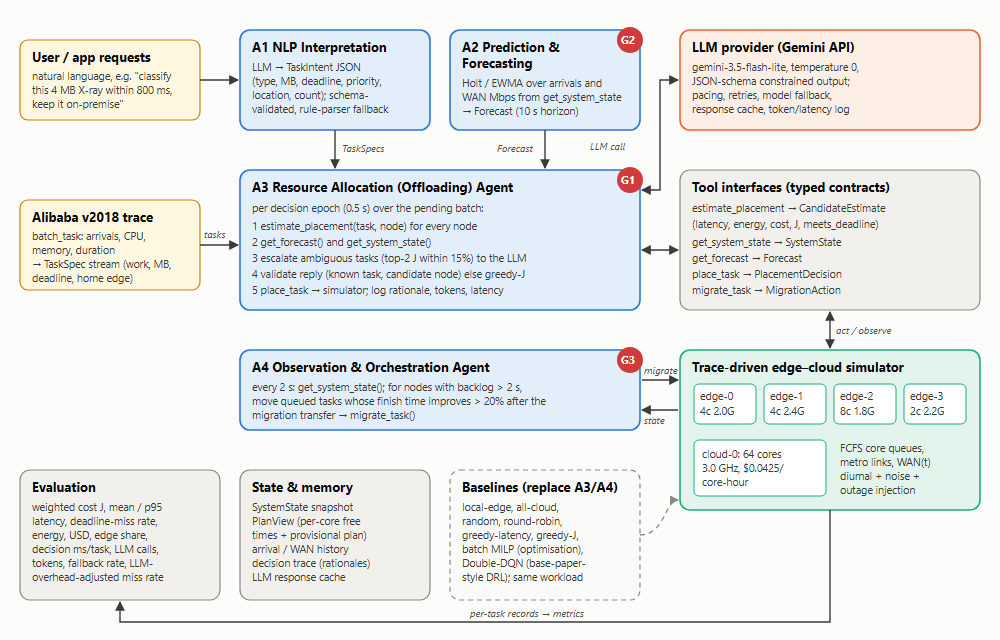

# Agentic AI in Edge–Cloud for Resource Management (G2-12)

AI4015 Agentic AI semester project, Phase 1 technical foundation.
Group: **Mohammad Rayyan Khan (22i-1002, group head)** · **Awwab Amir (22i-0971)**

A multi-agent framework that turns natural-language requests into tasks, forecasts load and WAN
bandwidth, decides where each task runs (edge or cloud), and keeps watching the system to migrate
queued work. It is evaluated in a **trace-driven simulator** (Alibaba cluster-trace-v2018) against
heuristic, optimisation (MILP) and deep-RL schedulers on identical workloads.



| Agent | Module | Phase 1 status |
|---|---|---|
| A1 NLP Interpretation | `src/ecagents/agents/nlp_agent.py` | Gemini → schema-validated `TaskIntent`; rule-parser fallback; evaluated on 40 labelled requests |
| A2 Prediction & Forecasting | `src/ecagents/agents/forecast_agent.py` | Holt / moving-average / naive; rolling evaluation on the Alibaba arrival series |
| A3 Resource Allocation | `src/ecagents/agents/allocation_agent.py` | tool-grounded LLM decisions for ambiguous tasks, validated, greedy fallback |
| A4 Observation & Orchestration | `src/ecagents/agents/orchestrator.py` | rule-based closed-loop migration (LLM reasoning planned for Phase 2) |

## Repository layout

```
configs/default.yaml          scenario: 4 edges + 1 cloud, network, prices, objective weights
data/processed/               Alibaba 2018 sample (6 h window, 49k tasks) + per-minute arrivals
data/eval/nl_requests.jsonl   40 natural-language requests with gold labels
docs/                         architecture diagram, formal offloading objective
src/ecagents/
  contracts.py                pydantic contracts (TaskIntent, TaskSpec, SystemState, Forecast,
                              CandidateEstimate, PlacementDecision, MigrationAction, EpisodeMetrics)
  trace.py                    trace → TaskSpec mapping
  sim/network.py              network, energy, money and weighted-cost (J) model
  sim/simulator.py            discrete-event simulator + PlanView (the estimate tool)
  schedulers/                 heuristics, batch MILP, Double-DQN baseline
  agents/                     LLM client + the four agents
  experiment.py               identical scenarios for every scheduler
scripts/                      data prep, experiments, evaluation, figures
tests/                        pytest suite
results/                      CSV/JSON outputs and figures
```

## How to run

```bash
python -m pip install -r requirements.txt
cp .env.example .env                    # then put your Gemini API key in .env (never commit it)
python scripts/prepare_trace.py --fetch # optional: re-download the trace sample (~12 MB stream)
python -m pytest -q                     # 13 tests
python scripts/run_baselines.py         # all baselines, 3 segments x 2 conditions (~10 min, CPU)
python scripts/eval_forecast.py         # forecasting agent models
python scripts/eval_nlp.py              # NLP agent vs rule parser (40 Gemini calls)
python scripts/run_agentic_demo.py      # end-to-end agentic workflow with Gemini
python scripts/make_figures.py
```

Without an API key every agent falls back to its deterministic policy, so all scripts still run.
The default model is `gemini-3.5-flash-lite` (set `GEMINI_MODEL` to change it); when a free-tier
daily quota runs out the client moves to the next model in `FALLBACK_MODELS`.

## Offloading objective

Minimise the mean per-task weighted cost
`J = 0.5·T/T_ref + 0.25·E/E_ref + 0.25·F/F_ref + 1[T > deadline]` (latency, energy, money,
deadline penalty), following the base paper's weighted cost but adding queueing, a time-varying
WAN and deadlines. Full definition: [docs/problem_formulation.md](docs/problem_formulation.md).

## Initial results (Phase 1)

Baselines, mean of three disjoint 3,000-task segments (`results/baseline_summary.csv`):

| Scheduler | J normal | miss normal | J WAN outage | miss WAN outage |
|---|---|---|---|---|
| greedy-weighted + orchestrator (A4) | **1.97** | 0.5% | **2.10** | 5.1% |
| greedy-weighted | 2.05 | 0.4% | 2.22 | 6.2% |
| greedy-latency | 2.07 | 0.6% | 2.11 | 2.8% |
| batch MILP | 2.21 | 4.6% | 2.40 | 10.2% |
| Double-DQN (base-paper-style DRL) | 2.45 | 9.4% | 2.76 | 14.6% |
| all-cloud | 2.65 | 3.1% | 3.21 | 15.6% |
| local-edge (no offloading) | 35.87 | 74.9% | 35.87 | 74.9% |

NLP agent (40 requests, `results/nlp_eval_summary.json`): exact-match 82.5% for Gemini (prompt v2)
vs 55% for the rule parser. Prompt v1 scored 65% (`results/nlp_eval_summary_prompt_v1.json`); its main
error was giving the total instead of the per-task input size. v2 was revised on the same set, so a
held-out split is planned.

End-to-end agentic run with live Gemini calls (`results/agentic_demo.csv`, `results/agent_trace.jsonl`):
the allocation agent's escalated choices matched weighted-greedy in 98–100% of cases, and counting the
~1.2 s LLM latency raised the deadline-miss rate of LLM-decided tasks from 2.6% to 9.7%. So far the LLM
adds overhead but not placement quality, which frames research gap G1.

These are starting points, not final claims: the DRL baseline is trained for only 24 episodes and
the LLM agent is not tuned yet.

## Data

Alibaba cluster-trace-v2018 `batch_task` (https://github.com/alibaba/clusterdata). The first
~12 MB of the archive (1.22 M usable tasks) is streamed; a 6-hour window (hours 48–54) is stored
in `data/processed/`. Arrivals are time-compressed to 6 tasks/s, and work and input size are
rescaled to edge magnitudes (see `src/ecagents/trace.py`).

## Work division

* **Mohammad Rayyan Khan**: A1 NLP Interpretation agent, A2 Prediction & Forecasting agent,
  data pipeline, NLP and forecasting evaluation.
* **Awwab Amir**: A3 Resource Allocation agent, A4 Observation & Orchestration agent,
  simulator, baseline schedulers (MILP, DRL).
* Both: contracts, integration, experiments and the report.
